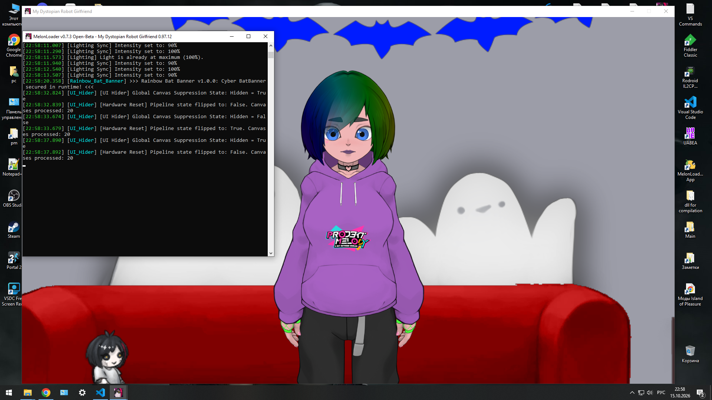
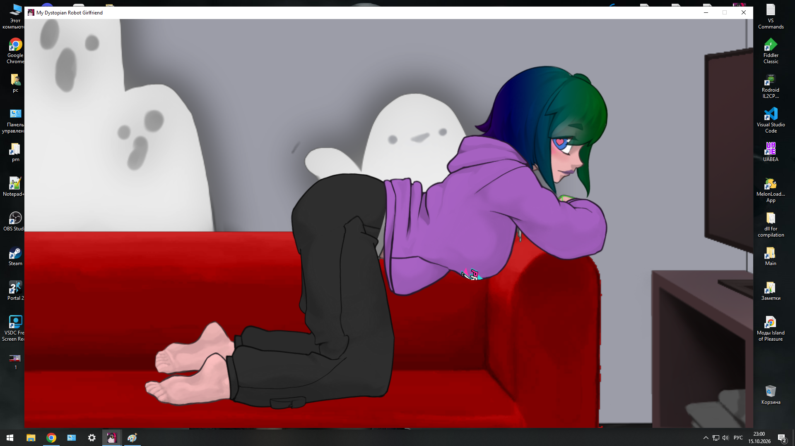
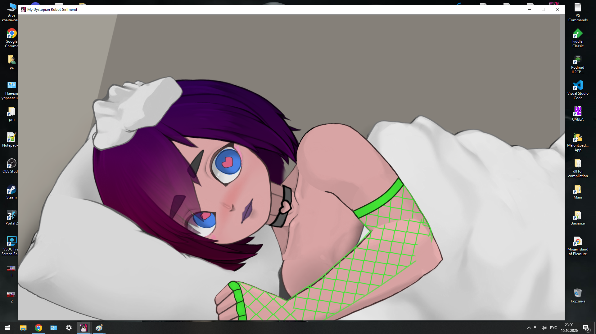

# 👁️ MDRG UI Hider

**Real-time user interface suppression for clean in-game screenshots**  
*Мгновенное скрытие интерфейса в реальном времени для создания чистых скриншотов*

**Author / Автор:** Paul.Epifancev ( #warlockforbugs )  
**Discord:** anon.jun  
**Version / Версия:** 1.0.0 (Stable Release / Стабильный релиз)  
**Compatibility / Совместимость:** PC (MelonLoader required / требуется MelonLoader)  
**Hotkey / Горячая клавиша:** Minus (`-`) on the main keyboard / Минус (`-`) на основной клавиатуре  

---

## 📸 Screenshots / Скриншоты

  
  
  

---

## 📖 About / О проекте

Полная документация и описание проекта доступны в исходном репозитории.

---

## ✨ Key Features / Ключевые возможности

* Моментальное переключение видимости элементов интерфейса. Instant switching of external interface elements.
* Нулевое влияние на производительность (FPS/CPU). Zero impact on performance (FPS/CPU).

---

## 🚀 Quick Start / Быстрый старт

1. Установите MelonLoader (v0.7.3+). Install MelonLoader (v0.7.3+).
2. Поместите `UI_Hider.dll` в директорию `Mods/`. Place `UI_Hider.dll` in the `Mods/` directory.
3. Нажимайте клавишу минус (`-`) в игре. Press the minus key (`-`) in the game.

---

## 🔧 Tech Stack & Author

* **Stack:** C#, MelonLoader, Unity IL2CPP Runtime.
* **License:** [MIT License](LICENSE).
